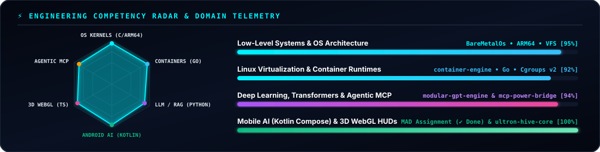

<div align="center">

<!-- ========================================================================================= -->
<!-- 1. WIDESCREEN CYBERPUNK MALE DEVELOPER NEURAL COMMAND DECK (CSS + SMIL ANIMATED SVG)      -->
<!-- ========================================================================================= -->
<a href="#-interactive-holographic-repository-deck">
  
</a>

<br/>

<!-- ANIMATED TERMINAL TYPING HEADER -->
<a href="https://github.com/Vanshverma-56">
  
</a>

<!-- LIVE TELEMETRY & RECRUITER STATUS PILLS -->
<p align="center">
  <a href="https://github.com/Vanshverma-56/N115_VanshV_Assignment1">
    
  </a>
  <a href="#-interactive-holographic-repository-deck">
    
  </a>
  <a href="https://github.com/Vanshverma-56?tab=repositories">
    
  </a>
  <a href="https://github.com/Vanshverma-56?tab=followers">
    
  </a>
</p>

<!-- ANIMATED EXECUTIVE TELEMETRY BAR -->


</div>

<br/>

---

## 🎮 Interactive Holographic Repository Deck
> **🕹️ DIRECT INTERFACE CONTROL:** Click any **Animated Holographic Card** below to **redirect immediately to its GitHub repository**, or click the **[🔍 INSPECT ARCHITECTURE]** buttons underneath each card to jump to its interactive deep-dive console!

<div align="center">
<table>
  <tr>
    <td width="50%" align="center" valign="top">
      <a href="https://github.com/Vanshverma-56/N115_VanshV_Assignment1">
        
      </a>
      <br/>
      <a href="#-zone-01--mobile-ai-module-mad-assignment--completed">
        
      </a>
      <a href="https://github.com/Vanshverma-56/N115_VanshV_Assignment1">
        
      </a>
    </td>
    <td width="50%" align="center" valign="top">
      <a href="https://github.com/Vanshverma-56/BareMetalOs">
        
      </a>
      <br/>
      <a href="#%EF%B8%8F-zone-02--kernel-core-terminal-baremetalos--in-progress">
        
      </a>
      <a href="https://github.com/Vanshverma-56/BareMetalOs">
        
      </a>
    </td>
  </tr>
  <tr>
    <td width="50%" align="center" valign="top">
      <a href="https://github.com/Vanshverma-56/container-engine">
        
      </a>
      <br/>
      <a href="#-zone-03--container-runtime-bay-container-engine--in-progress">
        
      </a>
      <a href="https://github.com/Vanshverma-56/container-engine">
        
      </a>
    </td>
    <td width="50%" align="center" valign="top">
      <a href="https://github.com/Vanshverma-56/modular-gpt-engine">
        
      </a>
      <br/>
      <a href="#-zone-04--neural-llm-matrix-modular-gpt-engine--in-progress">
        
      </a>
      <a href="https://github.com/Vanshverma-56/modular-gpt-engine">
        
      </a>
    </td>
  </tr>
  <tr>
    <td width="50%" align="center" valign="top">
      <a href="https://github.com/Vanshverma-56/mcp-power-bridge">
        
      </a>
      <br/>
      <a href="#-zone-05--ai-protocol-bridge-mcp-power-bridge--in-progress">
        
      </a>
      <a href="https://github.com/Vanshverma-56/mcp-power-bridge">
        
      </a>
    </td>
    <td width="50%" align="center" valign="top">
      <a href="https://github.com/Vanshverma-56/ultron-hive-core">
        
      </a>
      <br/>
      <a href="#%EF%B8%8F-zone-06--3d-holographic-visor-ultron-hive-core--in-progress">
        
      </a>
      <a href="https://github.com/Vanshverma-56/ultron-hive-core">
        
      </a>
    </td>
  </tr>
</table>
</div>

---

## 📡 Engineering Competency Radar & Domain Telemetry

<div align="center">
  
</div>

---

## 🖥️ Interactive Subsystem Inspection Consoles
*(Click on any holographic console bar below to toggle deep-dive architectural specs, internal subsystems, and direct repository launch controls)*

### 📱 Zone 01 // Mobile AI Module (`MAD Assignment`) — COMPLETED

<details open>
<summary><b>🟢 [CLICK TO INTERACT] N115_VanshV_Assignment1 (MAD Assignment) &nbsp;|&nbsp; STATUS: ✔ COMPLETED [100%]</b></summary>
<br/>

```diff
+ ==========================================================================================
+ MODULE IDENTIFIER : Vanshverma-56/N115_VanshV_Assignment1 (Mobile Application Development)
+ DEPLOYMENT STATUS : [████████████████████████████████] 100% COMPLETED & VERIFIED
+ CORE STACK        : Kotlin • Jetpack Compose • Android SDK • Google Gemini Generative AI
+ ==========================================================================================
```

| Subsystem / Feature | Engineering Implementation | Status |
| :--- | :--- | :---: |
| **Declarative UI Layer** | Modern reactive screens built 100% with **Jetpack Compose** & Material 3 | `✔ COMPLETED` |
| **Generative AI Engine** | Direct client integration with **Google Gemini API** for multimodal/text prompts | `✔ COMPLETED` |
| **State Management** | Unidirectional data flow (UDF) with Kotlin Coroutines & StateFlow | `✔ COMPLETED` |
| **Submission Pipeline** | Delivered and verified on dedicated assignment branch `N115-assignment-1` | `✔ COMPLETED` |

<p align="left">
  <a href="https://github.com/Vanshverma-56/N115_VanshV_Assignment1">
    
  </a>
  <a href="https://github.com/Vanshverma-56/N115_VanshV_Assignment1/tree/N115-assignment-1">
    
  </a>
</p>
</details>

---

### ⚙️ Zone 02 // Kernel Core Terminal (`BareMetalOs`) — IN PROGRESS

<details>
<summary><b>🟡 [CLICK TO INTERACT] BareMetalOs — ARM64 Micro-Kernel RTOS &nbsp;|&nbsp; STATUS: ⚡ IN PROGRESS</b></summary>
<br/>

```yaml
MODULE IDENTIFIER : Vanshverma-56/BareMetalOs
DEPLOYMENT STATUS : [█████████████████████████░░░░░░░] IN PROGRESS (Active Kernel R&D)
CORE STACK        : C • ARM64 Assembly • QEMU Emulation • Custom VFS • 3D Software Renderer
```

| Subsystem / Feature | Engineering Implementation | Status |
| :--- | :--- | :---: |
| **ARM64 Micro-Kernel** | Bare-metal boot sequence, exception vector tables, and preemptive task scheduling | `⚡ IN PROGRESS` |
| **Virtual File System (VFS)** | Custom hierarchical in-memory & block-backed filesystem abstraction | `⚡ IN PROGRESS` |
| **3D Graphics & Audio Synth** | Software-rendered 3D wireframe/polygon pipeline and PCM audio synthesizer | `⚡ IN PROGRESS` |
| **Cryptographic Vault & CLI** | Built-in encryption vault, interactive shell, and playable terminal games in QEMU | `⚡ IN PROGRESS` |

<p align="left">
  <a href="https://github.com/Vanshverma-56/BareMetalOs">
    
  </a>
  
</p>
</details>

---

### 📦 Zone 03 // Container Runtime Bay (`container-engine`) — IN PROGRESS

<details>
<summary><b>🟡 [CLICK TO INTERACT] container-engine — Linux Container Engine in Go &nbsp;|&nbsp; STATUS: ⚡ IN PROGRESS</b></summary>
<br/>

```yaml
MODULE IDENTIFIER : Vanshverma-56/container-engine
DEPLOYMENT STATUS : [████████████████████████░░░░░░░░] IN PROGRESS (Active Runtime R&D)
CORE STACK        : Go (Golang) • Linux Namespaces • Cgroups v2 • OverlayFS • Virtual Ethernet
```

| Subsystem / Feature | Engineering Implementation | Status |
| :--- | :--- | :---: |
| **Kernel Isolation** | Full process, network, mount, IPC, and UTS isolation via raw `syscall` Namespaces | `⚡ IN PROGRESS` |
| **Resource Governance** | Strict CPU, memory, and I/O throttling powered by Linux **Cgroups v2** | `⚡ IN PROGRESS` |
| **Layered Filesystem** | Copy-on-Write (CoW) container image layering utilizing **OverlayFS** | `⚡ IN PROGRESS` |
| **Virtual Networking** | Custom `veth` pairs, bridge interfaces, and NAT routing for container traffic | `⚡ IN PROGRESS` |

<p align="left">
  <a href="https://github.com/Vanshverma-56/container-engine">
    
  </a>
  
</p>
</details>

---

### 🧠 Zone 04 // Neural LLM Matrix (`modular-gpt-engine`) — IN PROGRESS

<details>
<summary><b>🟡 [CLICK TO INTERACT] modular-gpt-engine — Custom Transformer LLM &amp; RAG &nbsp;|&nbsp; STATUS: ⚡ IN PROGRESS</b></summary>
<br/>

```yaml
MODULE IDENTIFIER : Vanshverma-56/modular-gpt-engine
DEPLOYMENT STATUS : [███████████████████████░░░░░░░░░] IN PROGRESS (Active AI Research)
CORE STACK        : Python • PyTorch • Multi-Head Self-Attention • BPE Tokenizer • RAG
```

| Subsystem / Feature | Engineering Implementation | Status |
| :--- | :--- | :---: |
| **Transformer Backbone** | Custom causal multi-head self-attention, layer normalization, and residual blocks | `⚡ IN PROGRESS` |
| **Tokenization Pipeline** | Progression from character-level baselines to custom subword BPE tokenization | `⚡ IN PROGRESS` |
| **Training & Inference** | Distributed-ready training loop, KV-caching, and temperature/top-k sampling | `⚡ IN PROGRESS` |
| **RAG Integration** | Vector retrieval pipeline for grounding LLM responses on external knowledge | `⚡ IN PROGRESS` |

<p align="left">
  <a href="https://github.com/Vanshverma-56/modular-gpt-engine">
    
  </a>
  
</p>
</details>

---

### 🔌 Zone 05 // AI Protocol Bridge (`mcp-power-bridge`) — IN PROGRESS

<details>
<summary><b>🟡 [CLICK TO INTERACT] mcp-power-bridge — Model Context Protocol Server &nbsp;|&nbsp; STATUS: ⚡ IN PROGRESS</b></summary>
<br/>

```yaml
MODULE IDENTIFIER : Vanshverma-56/mcp-power-bridge
DEPLOYMENT STATUS : [█████████████████████████░░░░░░░] IN PROGRESS (Active Agentic R&D)
CORE STACK        : Python • FastMCP • Local Filesystem Scanner • SQL Query Engine
```

| Subsystem / Feature | Engineering Implementation | Status |
| :--- | :--- | :---: |
| **FastMCP Server Core** | Low-latency JSON-RPC / stdio & SSE protocol server for LLM tool invocation | `⚡ IN PROGRESS` |
| **Filesystem Telemetry** | Safe, sandboxed local directory traversal, code search, and file inspection | `⚡ IN PROGRESS` |
| **Database Query Bridge** | Live schema introspection and SQL execution tools exposed to AI assistants | `⚡ IN PROGRESS` |
| **System Automation** | Host diagnostics and automated workflow triggers for agentic coding | `⚡ IN PROGRESS` |

<p align="left">
  <a href="https://github.com/Vanshverma-56/mcp-power-bridge">
    
  </a>
  
</p>
</details>

---

### 🕶️ Zone 06 // 3D Holographic Visor (`ultron-hive-core`) — IN PROGRESS

<details>
<summary><b>🟡 [CLICK TO INTERACT] ultron-hive-core — 3D Ultron AI HUD Interface &nbsp;|&nbsp; STATUS: ⚡ IN PROGRESS</b></summary>
<br/>

```yaml
MODULE IDENTIFIER : Vanshverma-56/ultron-hive-core
DEPLOYMENT STATUS : [██████████████████████░░░░░░░░░░] IN PROGRESS (Active 3D WebGL R&D)
CORE STACK        : TypeScript • Next.js • Three.js • WebGL Shaders • Web Speech API
```

| Subsystem / Feature | Engineering Implementation | Status |
| :--- | :--- | :---: |
| **3D Holographic Core** | Real-time Three.js particle & geometric core with dynamic state-based lighting | `⚡ IN PROGRESS` |
| **Audio Reactivity** | Web Audio API frequency analyzer driving 3D mesh deformations & emissive glow | `⚡ IN PROGRESS` |
| **Voice Synthesis & ASR** | Browser-native Web Speech API for hands-free conversational AI interaction | `⚡ IN PROGRESS` |
| **Sci-Fi HUD Overlay** | Responsive Next.js tactical telemetry panels synchronized with AI state | `⚡ IN PROGRESS` |

<p align="left">
  <a href="https://github.com/Vanshverma-56/ultron-hive-core">
    
  </a>
  
</p>
</details>

---

## 🗺️ Interactive System Topology & Direct Redirect Graph
> **💡 Interactive Graph:** Every node in the architecture diagram below is bound to a live hyperlink—click any node to jump directly to that repository!

```mermaid
flowchart TB
    CORE(["👨‍💻 VANSH VERMA<br/>Neural Command Deck • @Vanshverma-56"])

    subgraph COMPLETED_ZONE["🟢 COMPLETED PRODUCTION DELIVERABLE (100%)"]
        MAD["📱 N115_VanshV_Assignment1<br/>MAD Assignment • Kotlin & Gemini AI<br/>STATUS: ✔ COMPLETED"]
    end

    subgraph ACTIVE_RD["🟡 IN-PROGRESS DEEP-TECH R&D PIPELINES"]
        direction LR
        OS["⚙️ BareMetalOs<br/>ARM64 Micro-Kernel RTOS (C)<br/>STATUS: ⚡ IN PROGRESS"]
        CONT["📦 container-engine<br/>Linux Runtime (Go)<br/>STATUS: ⚡ IN PROGRESS"]
        GPT["🧠 modular-gpt-engine<br/>Transformer LLM & RAG (Python)<br/>STATUS: ⚡ IN PROGRESS"]
        MCP["🔌 mcp-power-bridge<br/>FastMCP Server (Python)<br/>STATUS: ⚡ IN PROGRESS"]
        ULT["🕶️ ultron-hive-core<br/>3D Ultron AI HUD (TypeScript)<br/>STATUS: ⚡ IN PROGRESS"]
    end

    CORE ==>|"✔ 100% Verified"| MAD
    CORE -.->|"Kernel R&D"| OS
    CORE -.->|"Systems R&D"| CONT
    CORE -.->|"AI Core R&D"| GPT
    CORE -.->|"Agentic R&D"| MCP
    CORE -.->|"3D WebGL R&D"| ULT

    click CORE "https://github.com/Vanshverma-56" "Visit Vansh Verma's GitHub Profile"
    click MAD "https://github.com/Vanshverma-56/N115_VanshV_Assignment1" "Launch N115_VanshV_Assignment1 (MAD Assignment)"
    click OS "https://github.com/Vanshverma-56/BareMetalOs" "Launch BareMetalOs"
    click CONT "https://github.com/Vanshverma-56/container-engine" "Launch container-engine"
    click GPT "https://github.com/Vanshverma-56/modular-gpt-engine" "Launch modular-gpt-engine"
    click MCP "https://github.com/Vanshverma-56/mcp-power-bridge" "Launch mcp-power-bridge"
    click ULT "https://github.com/Vanshverma-56/ultron-hive-core" "Launch ultron-hive-core"

    style CORE fill:#090d16,stroke:#00f2fe,stroke-width:3px,color:#ffffff
    style MAD fill:#064e3b,stroke:#10b981,stroke-width:2.5px,color:#ecfdf5
    style OS fill:#0f172a,stroke:#00f2fe,stroke-width:2px,color:#f8fafc
    style CONT fill:#0f172a,stroke:#38bdf8,stroke-width:2px,color:#f8fafc
    style GPT fill:#0f172a,stroke:#a855f7,stroke-width:2px,color:#f8fafc
    style MCP fill:#0f172a,stroke:#f59e0b,stroke-width:2px,color:#f8fafc
    style ULT fill:#0f172a,stroke:#ec4899,stroke-width:2px,color:#f8fafc
```



---

## 🛠️ Polyglot Engineering Arsenal

<div align="center">
  <a href="https://github.com/Vanshverma-56?tab=repositories">
    
  </a>
</div>

<br/>

<div align="center">
  
</div>
