<!-- ========================================================================================= -->
<!-- MINIMALIST FLOATING PROJECT CONSTELLATION HERO                                            -->
<!-- ========================================================================================= -->

  

## ✨ Interactive Project Bubbles
Click any floating bubble below to expand its core idea, tech stack, completion status, and repository link.

  

<!-- BUBBLE 1: MAD ASSIGNMENT (COMPLETED) -->

 

> **📱 MAD Assignment (`N115_VanshV_Assignment1`)** &nbsp;·&nbsp; 
>
> **Core Idea:** Native Android generative AI application built with declarative UI and Google's Gemini API.
>
> **Tech Stack:** `Kotlin` · `Jetpack Compose` · `Google Gemini API` · `Android SDK`
>
> [**↗ Open Repository**](https://github.com/Vanshverma-56/N115_VanshV_Assignment1) &nbsp;|&nbsp; [**🌿 View Assignment Branch (`N115-assignment-1`)**](https://github.com/Vanshverma-56/N115_VanshV_Assignment1/tree/N115-assignment-1)

 

<!-- BUBBLE 2: BAREMETALOS (IN PROGRESS) -->

 

> **⚙️ `BareMetalOs`** &nbsp;·&nbsp; 
>
> **Core Idea:** Lightweight ARM64 micro-kernel Real-Time OS featuring a custom VFS, 3D graphics engine, cryptographic vault, audio synth, and CLI games in QEMU.
>
> **Tech Stack:** `C` · `ARM64 Assembly` · `Custom VFS` · `QEMU`
>
> [**↗ Open Repository**](https://github.com/Vanshverma-56/BareMetalOs)

 

<!-- BUBBLE 3: CONTAINER-ENGINE (IN PROGRESS) -->

 

> **🐳 `container-engine`** &nbsp;·&nbsp; 
>
> **Core Idea:** Lightweight custom Linux container runtime engineered from scratch using kernel primitives without Docker.
>
> **Tech Stack:** `Go (Golang)` · `Linux Namespaces` · `Cgroups v2` · `OverlayFS` · `Virtual Ethernet`
>
> [**↗ Open Repository**](https://github.com/Vanshverma-56/container-engine)

 

<!-- BUBBLE 4: MODULAR-GPT-ENGINE (IN PROGRESS) -->

 

> **🧠 `modular-gpt-engine`** &nbsp;·&nbsp; 
>
> **Core Idea:** End-to-end modular framework for building and training a custom Transformer LLM from character baselines up to subword tokenization and RAG pipelines.
>
> **Tech Stack:** `Python` · `PyTorch` · `Transformer Self-Attention` · `Subword BPE` · `RAG`
>
> [**↗ Open Repository**](https://github.com/Vanshverma-56/modular-gpt-engine)

 

<!-- BUBBLE 5: MCP-POWER-BRIDGE (IN PROGRESS) -->

 

> **🔌 `mcp-power-bridge`** &nbsp;·&nbsp; 
>
> **Core Idea:** Custom local Model Context Protocol (MCP) server bridging AI assistants with local filesystem scanning, database querying, and host automation.
>
> **Tech Stack:** `Python` · `FastMCP` · `SQLite / Database Querying` · `System Automation`
>
> [**↗ Open Repository**](https://github.com/Vanshverma-56/mcp-power-bridge)

 

<!-- BUBBLE 6: ULTRON-HIVE-CORE (IN PROGRESS) -->

 

> **🕶️ `ultron-hive-core`** &nbsp;·&nbsp; 
>
> **Core Idea:** Interactive 3D Ultron-themed AI interface featuring dynamic state-based core lighting and real-time voice/audio reactivity.
>
> **Tech Stack:** `TypeScript` · `Next.js` · `Three.js` · `Web Speech API`
>
> [**↗ Open Repository**](https://github.com/Vanshverma-56/ultron-hive-core)

 

 

---

 

### 🛠️ Core Technologies

  

