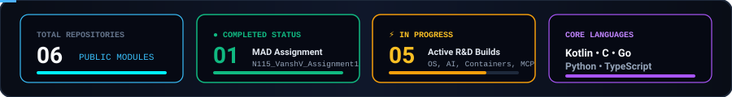
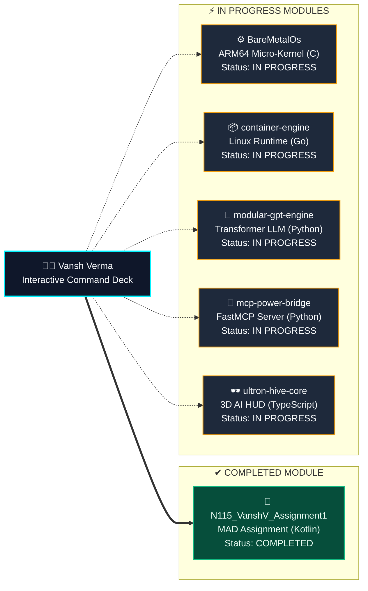

<div align="center">

<!-- ANIMATED MALE DEVELOPER COMMAND DECK HUD -->
<a href="https://github.com/Vanshverma-56?tab=repositories">
  
</a>

<br/>

<!-- ANIMATED TYPING SUBTITLE -->
<a href="https://github.com/Vanshverma-56">
  
</a>

<p align="center">
  <a href="https://github.com/Vanshverma-56?tab=followers">
    
  </a>
  <a href="https://github.com/Vanshverma-56?tab=repositories">
    
  </a>
  <a href="https://github.com/Vanshverma-56/N115_VanshV_Assignment1">
    
  </a>
  <a href="#-interactive-interface-control-deck">
    
  </a>
</p>

<!-- TELEMETRY OVERVIEW BAR -->


</div>

---

## 🎮 Interactive Interface Control Deck

> **How to use this interface:** Click on any **Interface Zone** in the quick-navigation matrix below, or click to **expand the interactive HUD consoles** right underneath to inspect architecture specs, view repository status, and **launch directly into the repository**.

<div align="center">
<table>
  <thead>
    <tr>
      <th align="center">🕹️ Interface Zone</th>
      <th align="left">📦 Target Repository</th>
      <th align="center">🛠️ Tech Stack</th>
      <th align="center">📡 Live Status</th>
      <th align="center">🚀 Direct Redirect</th>
    </tr>
  </thead>
  <tbody>
    <tr>
      <td align="center"><a href="#-zone-01--mobile-ai-module-mad-assignment"><code>[ZONE 01 : MOBILE HUD]</code></a></td>
      <td><b><a href="https://github.com/Vanshverma-56/N115_VanshV_Assignment1">N115_VanshV_Assignment1</a></b> <i>(MAD Assignment)</i></td>
      <td align="center"></td>
      <td align="center"></td>
      <td align="center"><a href="https://github.com/Vanshverma-56/N115_VanshV_Assignment1"></a></td>
    </tr>
    <tr>
      <td align="center"><a href="#-zone-02--kernel-core-terminal-baremetalos"><code>[ZONE 02 : KERNEL CORE]</code></a></td>
      <td><b><a href="https://github.com/Vanshverma-56/BareMetalOs">BareMetalOs</a></b></td>
      <td align="center"></td>
      <td align="center"></td>
      <td align="center"><a href="https://github.com/Vanshverma-56/BareMetalOs"></a></td>
    </tr>
    <tr>
      <td align="center"><a href="#-zone-03--container-runtime-bay-container-engine"><code>[ZONE 03 : RUNTIME BAY]</code></a></td>
      <td><b><a href="https://github.com/Vanshverma-56/container-engine">container-engine</a></b></td>
      <td align="center"></td>
      <td align="center"></td>
      <td align="center"><a href="https://github.com/Vanshverma-56/container-engine"></a></td>
    </tr>
    <tr>
      <td align="center"><a href="#-zone-04--neural-llm-matrix-modular-gpt-engine"><code>[ZONE 04 : NEURAL CORTEX]</code></a></td>
      <td><b><a href="https://github.com/Vanshverma-56/modular-gpt-engine">modular-gpt-engine</a></b></td>
      <td align="center"></td>
      <td align="center"></td>
      <td align="center"><a href="https://github.com/Vanshverma-56/modular-gpt-engine"></a></td>
    </tr>
    <tr>
      <td align="center"><a href="#-zone-05--ai-protocol-bridge-mcp-power-bridge"><code>[ZONE 05 : MCP BRIDGE]</code></a></td>
      <td><b><a href="https://github.com/Vanshverma-56/mcp-power-bridge">mcp-power-bridge</a></b></td>
      <td align="center"></td>
      <td align="center"></td>
      <td align="center"><a href="https://github.com/Vanshverma-56/mcp-power-bridge"></a></td>
    </tr>
    <tr>
      <td align="center"><a href="#-zone-06--3d-holographic-visor-ultron-hive-core"><code>[ZONE 06 : 3D HOLO VISOR]</code></a></td>
      <td><b><a href="https://github.com/Vanshverma-56/ultron-hive-core">ultron-hive-core</a></b></td>
      <td align="center"></td>
      <td align="center"></td>
      <td align="center"><a href="https://github.com/Vanshverma-56/ultron-hive-core"></a></td>
    </tr>
  </tbody>
</table>
</div>

---

## 🖥️ Interactive Repository Inspection Consoles
*(Click on any console header below to expand/collapse interactive project telemetry and launch links)*

### 📱 Zone 01 // Mobile AI Module (`MAD Assignment`)

<details open>
<summary><b>🟢 [CLICK TO INTERACT] N115_VanshV_Assignment1 — Mobile Application Development (MAD) Assignment &nbsp;|&nbsp; Status: COMPLETED ✔</b></summary>
<br/>

```diff
+ ===============================================================================
+ MODULE ID       : N115_VanshV_Assignment1 (MAD Assignment 1)
+ STATUS          : [████████████████████████████████] 100% COMPLETED
+ ARCHITECTURE    : Android Native • Kotlin • Jetpack Compose • Google Gemini API
+ ===============================================================================
```

- **Overview:** Mobile Application Development (MAD) Assignment built with modern Android architecture, integrating generative AI capabilities via the Gemini API and reactive UI components using Jetpack Compose.
- **Key Highlights:**
  - Reactive state management & declarative UI with Jetpack Compose.
  - Seamless integration with Google's Gemini API starter template.
  - Completed and submitted via feature branch `N115-assignment-1`.

<p align="left">
  <a href="https://github.com/Vanshverma-56/N115_VanshV_Assignment1">
    
  </a>
  <a href="https://github.com/Vanshverma-56/N115_VanshV_Assignment1/tree/N115-assignment-1">
    
  </a>
</p>
</details>

---

### ⚙️ Zone 02 // Kernel Core Terminal (`BareMetalOs`)

<details>
<summary><b>🟡 [CLICK TO INTERACT] BareMetalOs — ARM64 Micro-Kernel RTOS &nbsp;|&nbsp; Status: IN PROGRESS ⚡</b></summary>
<br/>

```yaml
MODULE ID       : BareMetalOs
STATUS          : [████████████████████████░░░░░░░░] IN PROGRESS (Active R&D)
ARCHITECTURE    : C • ARM64 Assembly • QEMU Virtualization • Custom VFS
```

- **Overview:** A lightweight ARM64 micro-kernel Real-Time Operating System (RTOS) engineered from the ground up running in QEMU.
- **Subsystems Included:**
  - **Custom VFS:** Virtual File System layer for low-level storage management.
  - **3D Graphics & Audio Synth:** Custom software-rendered 3D engine and audio synthesizer.
  - **Cryptographic Vault & CLI Games:** Built-in security primitives and interactive terminal games.

<p align="left">
  <a href="https://github.com/Vanshverma-56/BareMetalOs">
    
  </a>
  
</p>
</details>

---

### 📦 Zone 03 // Container Runtime Bay (`container-engine`)

<details>
<summary><b>🟡 [CLICK TO INTERACT] container-engine — Custom Linux Container Runtime in Go &nbsp;|&nbsp; Status: IN PROGRESS ⚡</b></summary>
<br/>

```yaml
MODULE ID       : container-engine
STATUS          : [██████████████████████░░░░░░░░░░] IN PROGRESS (Active R&D)
ARCHITECTURE    : Go (Golang) • Linux Namespaces • Cgroups v2 • OverlayFS • Veth
```

- **Overview:** A lightweight custom container runtime built from scratch in Go using low-level Linux kernel primitives without relying on Docker.
- **Subsystems Included:**
  - **Process Isolation:** Linux Namespaces (`PID`, `UTS`, `MNT`, `NET`, `IPC`).
  - **Resource Governance:** Cgroups v2 for strict CPU and memory limits.
  - **Layered Storage & Networking:** OverlayFS copy-on-write filesystems and Virtual Ethernet (`veth`) bridge networking.

<p align="left">
  <a href="https://github.com/Vanshverma-56/container-engine">
    
  </a>
  
</p>
</details>

---

### 🧠 Zone 04 // Neural LLM Matrix (`modular-gpt-engine`)

<details>
<summary><b>🟡 [CLICK TO INTERACT] modular-gpt-engine — End-to-End Custom Transformer LLM &amp; RAG &nbsp;|&nbsp; Status: IN PROGRESS ⚡</b></summary>
<br/>

```yaml
MODULE ID       : modular-gpt-engine
STATUS          : [███████████████████████░░░░░░░░░] IN PROGRESS (Active R&D)
ARCHITECTURE    : Python • PyTorch • Custom Self-Attention • Subword Tokenization • RAG
```

- **Overview:** A modular, end-to-end framework for building a custom Transformer Large Language Model from scratch.
- **Subsystems Included:**
  - **Progressive Architecture:** Scales from raw character-level baselines up to BPE/subword tokenization.
  - **Attention & Training Loop:** Multi-head self-attention blocks, custom positional encodings, and checkpointing.
  - **RAG Pipeline:** Retrieval-Augmented Generation pipeline for grounded context injection.

<p align="left">
  <a href="https://github.com/Vanshverma-56/modular-gpt-engine">
    
  </a>
  
</p>
</details>

---

### 🔌 Zone 05 // AI Protocol Bridge (`mcp-power-bridge`)

<details>
<summary><b>🟡 [CLICK TO INTERACT] mcp-power-bridge — Model Context Protocol (MCP) Server &nbsp;|&nbsp; Status: IN PROGRESS ⚡</b></summary>
<br/>

```yaml
MODULE ID       : mcp-power-bridge
STATUS          : [████████████████████████░░░░░░░░] IN PROGRESS (Active R&D)
ARCHITECTURE    : Python • FastMCP • SQLite/DB Querying • System Automation
```

- **Overview:** A custom local Model Context Protocol (MCP) server engineered with Python and FastMCP to connect AI assistants directly to local host tooling.
- **Subsystems Included:**
  - **Filesystem Intelligence:** Real-time local directory scanning and code inspection tools.
  - **Database & System Bridge:** Direct database querying and automated system execution endpoints for agentic workflows.

<p align="left">
  <a href="https://github.com/Vanshverma-56/mcp-power-bridge">
    
  </a>
  
</p>
</details>

---

### 🕶️ Zone 06 // 3D Holographic Visor (`ultron-hive-core`)

<details>
<summary><b>🟡 [CLICK TO INTERACT] ultron-hive-core — 3D Ultron-Themed AI HUD Interface &nbsp;|&nbsp; Status: IN PROGRESS ⚡</b></summary>
<br/>

```yaml
MODULE ID       : ultron-hive-core
STATUS          : [█████████████████████░░░░░░░░░░░] IN PROGRESS (Active R&D)
ARCHITECTURE    : TypeScript • Next.js • Three.js • Web Speech API • 3D Shaders
```

- **Overview:** An interactive, 3D Ultron-themed HUD AI interface built with Next.js, Three.js, and the Web Speech API.
- **Subsystems Included:**
  - **Audio-Reactive 3D Core:** Dynamic state-based core lighting and geometry reacting to real-time voice synthesis.
  - **Voice Command Interface:** Browser-native speech recognition and holographic HUD telemetry overlays.

<p align="left">
  <a href="https://github.com/Vanshverma-56/ultron-hive-core">
    
  </a>
  
</p>
</details>

---

## 🗺️ Interactive System Architecture & Navigation Map

> Every node in the diagram below is **clickable** in GitHub's Mermaid viewer—click any project node to jump straight to its GitHub repository!



---

<div align="center">
  
  <br/><br/>
  <sub>⚡ Engineered by <b><a href="https://github.com/Vanshverma-56">Vansh Verma (@Vanshverma-56)</a></b> • Interactive Profile Command Deck</sub>
</div>
