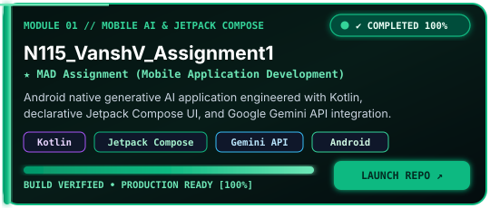
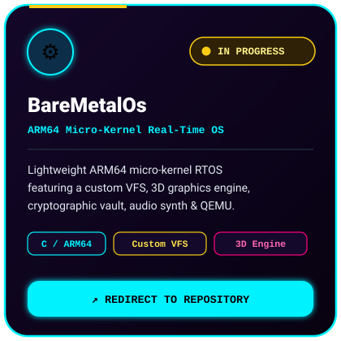
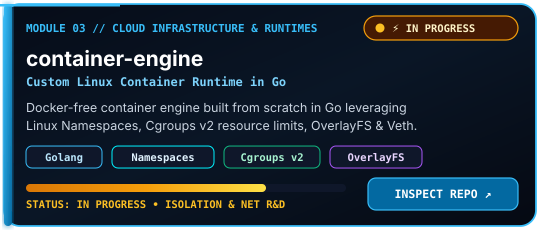
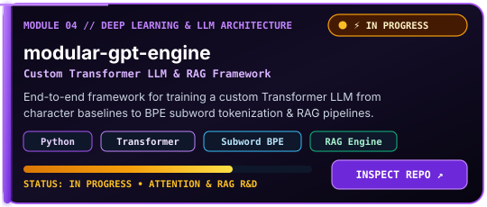
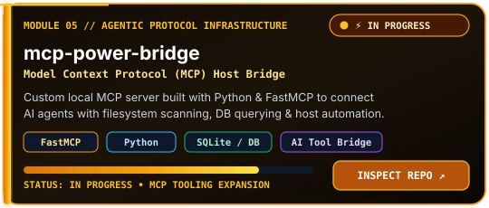
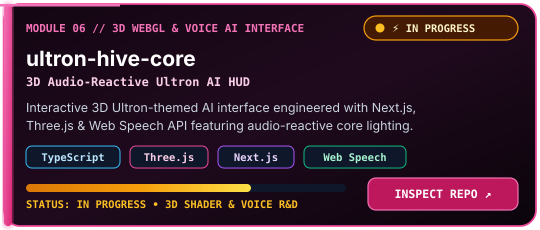

<!-- ========================================================================================= -->
<!-- CYBERPUNK 2077: EDGERUNNERS — ENLARGED DYNAMIC NIGHT CITY SCENE (3 FEATURED REPOS)        -->
<!-- ========================================================================================= -->

  

Click any repository card below to view its core purpose, tech stack, completion status, and redirect directly to the repository.

  

<!-- ========================================================================================= -->
<!-- 6 SQUARE REPOSITORY CARDS (2 PER ROW) — DIRECT REDIRECT ON CLICK                          -->
<!-- ========================================================================================= -->
<table>
  <tr>
    <td width="50%" align="center">
      
    </td>
    <td width="50%" align="center">
      
    </td>
  </tr>
  <tr>
    <td width="50%" align="center">
      
    </td>
    <td width="50%" align="center">
      
    </td>
  </tr>
  <tr>
    <td width="50%" align="center">
      
    </td>
    <td width="50%" align="center">
      
    </td>
  </tr>
</table>

 

---

 

  

